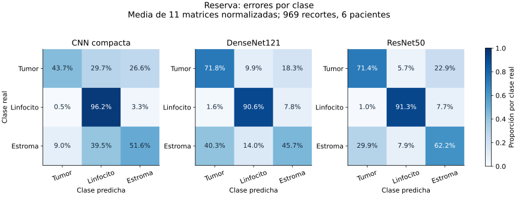

# Resultados acumulados: E1, E2 y frontera E3

Las tablas provienen de los mismos CSV que alimentan el dashboard. **No se mezclan** cierres con distintas semillas, particiones y propósitos. Las medias de validación de E1/E2 no se comparan directamente con la mejor época de una semilla CICO para declarar superioridad.

## E1 · tres bases y 11 semillas

| modelo | R | baseline | macro_f1_val_media | macro_f1_val_sd | IC95_semillas_inf | IC95_semillas_sup | macro_f1_reserva_media | macro_f1_reserva_sd |
|---|---|---|---|---|---|---|---|---|
| softmaxcnn_bn | 11 | False | 0.7568 | 0.0255 | 0.7397 | 0.7739 | 0.4542 | 0.0717 |
| densenet121 | 11 | False | 0.7783 | 0.0254 | 0.7612 | 0.7953 | 0.6052 | 0.1112 |
| resnet50 | 11 | True | 0.7934 | 0.0173 | 0.7818 | 0.8051 | 0.6378 | 0.0518 |

La tabla preserva las columnas y cifras del cierre original. El intervalo entre semillas no convierte las imágenes del mismo paciente en observaciones independientes.

La matriz identifica clases confundidas en el cierre E1. No corresponde a CICO ni explica por sí sola la causa morfológica de los errores.

La calibración contrasta confianza con frecuencia observada; no se traslada automáticamente a otro dominio o modelo.

## E2 · ampliación de las bases a 22 semillas

| modelo | n | media | sd | IC95_inf | IC95_sup |
|---|---|---|---|---|---|
| softmaxcnn_bn | 22 | 0.7600 | 0.0219 | 0.7503 | 0.7697 |
| densenet121 | 22 | 0.7846 | 0.0217 | 0.7750 | 0.7942 |
| resnet50 | 22 | 0.7922 | 0.0227 | 0.7822 | 0.8023 |

Son 66 registros de desarrollo (tres modelos × 22), distintos de las 65 evaluaciones de reserva. La auditoría de las predicciones y curvas individuales de las 66 corridas continúa como pendiente documental.

### Contrastes pareados de desarrollo

| comparacion | n | diferencia | sd_diferencias | IC95_inf | IC95_sup | cohen_dz | hedges_gz | rank_biserial | shapiro_p | t_p | wilcoxon_p | permutacion_p | MDE80_familia3 | MDE80_familia10 | potencia_delta002_familia10 | R_delta002_familia10 | t_p_Holm | wilcoxon_p_Holm | permutacion_p_Holm |
|---|---|---|---|---|---|---|---|---|---|---|---|---|---|---|---|---|---|---|---|
| resnet50 - densenet121 | 22 | 0.0077 | 0.0255 | -0.0037 | 0.0190 | 0.2996 | 0.2888 | 0.3755 | 0.5163 | 0.1745 | 0.1289 | 0.1750 | 0.0189 | 0.0220 | 0.6981 | 26 | 0.1745 | 0.1289 | 0.1750 |
| resnet50 - softmaxcnn_bn | 22 | 0.0322 | 0.0340 | 0.0171 | 0.0473 | 0.9469 | 0.9127 | 0.8103 | 0.0597 | 0.0002 | 0.0004 | 0.0005 | 0.0252 | 0.0292 | 0.3802 | 43 | 0.0007 | 0.0011 | 0.0014 |
| densenet121 - softmaxcnn_bn | 22 | 0.0246 | 0.0282 | 0.0121 | 0.0370 | 0.8720 | 0.8405 | 0.7708 | 0.4885 | 0.0005 | 0.0008 | 0.0006 | 0.0209 | 0.0242 | 0.5839 | 31 | 0.0010 | 0.0016 | 0.0014 |

## E2 · reserva histórica, 13 arquitecturas × 5 semillas

Reserva: 969 recortes de seis pacientes, ya observada en E1/E2. No es una prueba sellada nueva para E3. La desviación entre semillas y el intervalo por paciente describen fuentes de incertidumbre diferentes.

| modelo | R | macro_f1_media | macro_f1_sd | IC95_paciente_inf | IC95_paciente_sup |
|---|---|---|---|---|---|
| softmaxcnn_bn | 5 | 0.4742 | 0.0619 | 0.2933 | 0.5924 |
| densenet121 | 5 | 0.6379 | 0.0600 | 0.4686 | 0.6978 |
| resnet50 | 5 | 0.6669 | 0.0349 | 0.4972 | 0.7402 |
| resnet18 | 5 | 0.5260 | 0.0654 | 0.3161 | 0.6692 |
| mobilenetv3_small_100 | 5 | 0.6504 | 0.0298 | 0.4812 | 0.7202 |
| efficientnet_b0 | 5 | 0.6758 | 0.0312 | 0.4921 | 0.7564 |
| deit_tiny_patch16_224 | 5 | 0.6117 | 0.0282 | 0.4583 | 0.6823 |
| swin_tiny_patch4_window7_224 | 5 | 0.4942 | 0.0499 | 0.2859 | 0.6222 |
| mobilevit_xxs | 5 | 0.6053 | 0.0722 | 0.4302 | 0.6664 |
| mixer_s16_224 | 5 | 0.6007 | 0.0269 | 0.4312 | 0.6662 |
| convnext_tiny | 5 | 0.5162 | 0.0269 | 0.3133 | 0.6314 |
| inception_v3 | 5 | 0.7204 | 0.0333 | 0.5546 | 0.7753 |
| sequencer2d_s | 5 | 0.4332 | 0.0492 | 0.2530 | 0.5641 |

### Ablaciones de preprocesamiento E2

15 corridas: cinco por intervención (rotación, reflejo y estandarización). No sustituyen ablaciones del mecanismo propio CICO. Las cifras conservan ajuste de Holm; ausencia de significación no demuestra equivalencia.

| ablacion | delta | IC95_t_inf | IC95_t_sup | p_t_Holm3 | p_wilcoxon_Holm3 | p_permutacion_Holm3 |
|---|---|---|---|---|---|---|
| sin_rotacion | -0.0332 | -0.0774 | 0.0110 | 0.3073 | 0.1875 | 0.1875 |
| sin_reflejo | -0.0220 | -0.0509 | 0.0069 | 0.3073 | 0.3750 | 0.3750 |
| sin_estandarizacion | -0.0307 | -0.0712 | 0.0099 | 0.3073 | 0.3750 | 0.3750 |

### Ensambles y calibración histórica

| modelo | n_semillas | n | pacientes | macro_f1_ensemble | macro_f1_individual_media | ece_fijo10 | brier | entropia_media | informacion_mutua_media | IC95_paciente_inf | IC95_paciente_sup |
|---|---|---|---|---|---|---|---|---|---|---|---|
| efficientnet_b0 | 5 | 969 | 6 | 0.7275 | 0.6758 | 0.0842 | 0.2271 | 0.5379 | 0.0738 | 0.5232 | 0.7983 |
| inception_v3 | 5 | 969 | 6 | 0.7496 | 0.7204 | 0.0689 | 0.1916 | 0.4696 | 0.0470 | 0.5610 | 0.8048 |
| resnet18 | 5 | 969 | 6 | 0.5268 | 0.5260 | 0.1114 | 0.4743 | 0.6586 | 0.1593 | 0.2721 | 0.7061 |

### Costos registrados

Son registros del entorno experimental histórico, no una medición de latencia CPU en Render.

| modelo | parametros | latencia_ms_por_recorte_batch32 | memoria_pico_inferencia_bytes | FLOPs_operaciones_cubiertas_por_profiler |
|---|---|---|---|---|
| convnext_tiny | 27822435.0000 | 1.3519 | 290473984.0000 | 2910638592.0000 |
| deit_tiny_patch16_224 | 5499651.0000 | 0.4133 | 81037312.0000 | 748368960.0000 |
| densenet121 | 6956931.0000 | 1.0572 | 172984832.0000 | 1850218496.0000 |
| efficientnet_b0 | 4011391.0000 | 0.4519 | 181968896.0000 | 252798976.0000 |
| inception_v3 | 21791715.0000 | 0.7085 | 219571200.0000 | 1461318336.0000 |
| mixer_s16_224 | 17475075.0000 | 1.0785 | 160604672.0000 | 2466778112.0000 |
| mobilenetv3_small_100 | 1520931.0000 | 0.2714 | 75400192.0000 | 37765120.0000 |
| mobilevit_xxs | 951987.0000 | 0.5131 | 102461952.0000 | 174493056.0000 |
| resnet18 | 11178051.0000 | 0.3319 | 151721472.0000 | 1184369664.0000 |
| resnet50 | 23514179.0000 | 1.0183 | 243202048.0000 | 2669162496.0000 |
| sequencer2d_s | 27267843.0000 | 3.2656 | 248578048.0000 | 3125083392.0000 |
| softmaxcnn_bn | 898687.0000 | 0.2240 | 187456000.0000 | 167730560.0000 |
| swin_tiny_patch4_window7_224 | 27515901.0000 | 2.1306 | 332778496.0000 | 4086801555.0000 |

## E3 · comparación todavía pendiente

CICO tiene avance piloto comunicado. Falta recibir artefactos, completar cinco semillas y diseñar la evaluación final con toda la familia y tamaño suficiente. No existe todavía una tabla final que compare CICO con los 13 modelos bajo condiciones verificadamente iguales.

[Explorar estas mismas tablas y gráficos](https://nucls-entregable3.onrender.com/proyecto).
