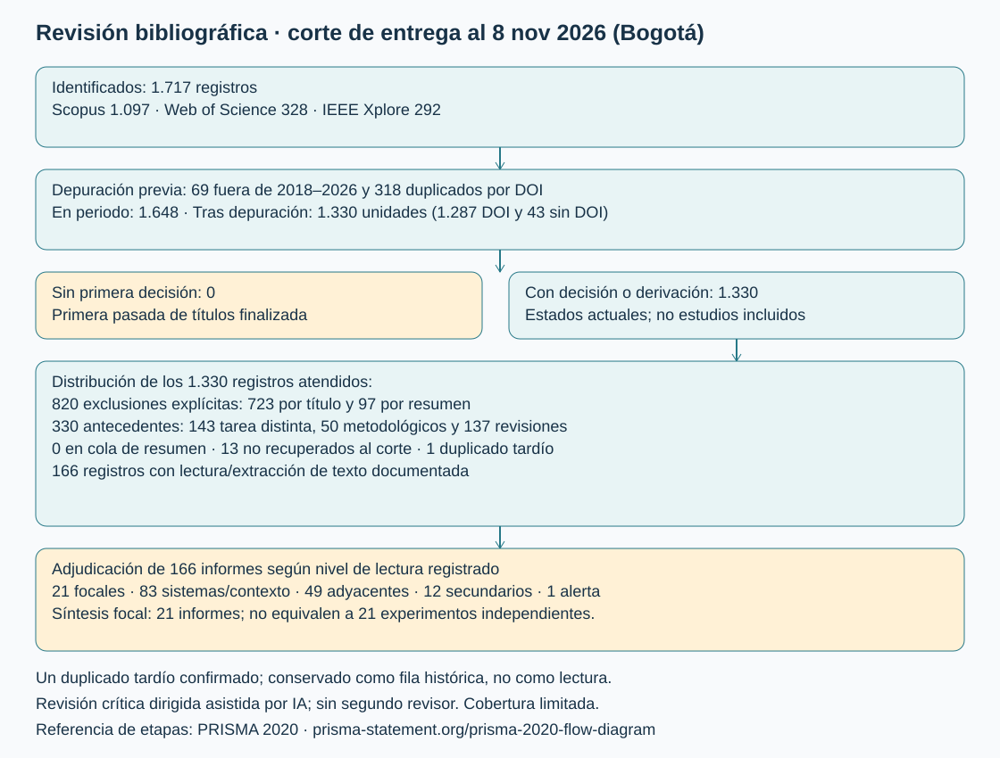
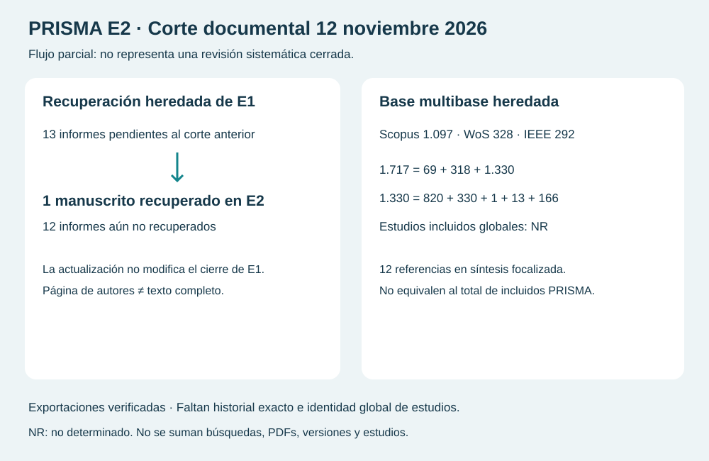
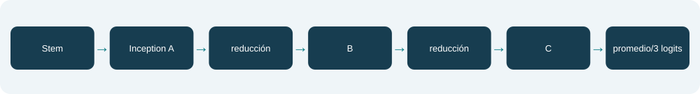
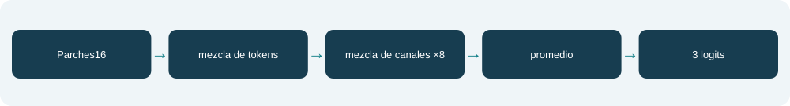
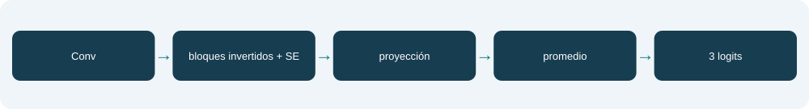
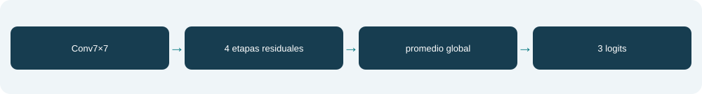

# Literatura acumulada y vigilancia de novedad

## E1 · búsqueda y selección documentadas

La búsqueda heredada identificó 1.717 registros (Scopus 1.097, Web of Science 328, IEEE Xplore 292), con 1.330 unidades de cribado tras filtros documentados. Es una revisión crítica dirigida con límites, no una revisión sistemática nueva completada por esta integración. Los conteos son del corte original del 8 de noviembre; E2 conserva su actualización separada.



## E2 · selección de diez arquitecturas adicionales

Se mantienen separadas de las tres bases. La evidencia de cierre incluye trece arquitecturas; el número de arquitecturas no demuestra suficiencia estadística de cinco semillas.



## E3 · actualización documental del 18 de noviembre

La contribución candidata es una **corrección contextual de logits con norma acotada y amortiguación por dispersión de orientaciones**. No se reivindican como nuevos ni D4, ni el contexto, ni las compuertas. La ausencia de coincidencias en esta revisión no demuestra originalidad.

NuClass combina expertos locales y globales en el espacio de probabilidades, con señales de confianza y aprendizaje de la compuerta. CICO plantea una corrección aditiva limitada sobre una cabeza central. Esta diferencia de formulación justifica un contraste experimental, no una afirmación de prioridad. Fuente: https://arxiv.org/html/2511.13586v1 (secciones 3.1–3.3).

Equi-ViT incorpora equivariancia al embedding de parches; DSF-CNN usa filtros orientables. Ambos obligan a reconocer los antecedentes de simetría y a comparar costo total, incluidos los ocho pases del encoder de CICO. Fuentes: https://arxiv.org/html/2601.09130v1 y https://arxiv.org/abs/2004.03037.

MOSAIC se registra como texto por recuperar; la página editorial devolvió 403. No se cuenta como lectura completa. La matriz conserva el nivel de lectura de cada registro. Son ocho antecedentes de vigilancia de novedad, no ocho estudios incluidos mediante un PRISMA nuevo. El PRISMA E1/E2 permanece intacto.

## Diagramas de los candidatos E2

### convnext_tiny


Diagrama heredado de E2; representa la arquitectura documentada, no una explicación de atención sobre una imagen.

### deit_tiny_patch16_224


Diagrama heredado de E2; representa la arquitectura documentada, no una explicación de atención sobre una imagen.

### efficientnet_b0


Diagrama heredado de E2; representa la arquitectura documentada, no una explicación de atención sobre una imagen.

### inception_v3



Diagrama heredado de E2; representa la arquitectura documentada, no una explicación de atención sobre una imagen.

### mixer_s16_224



Diagrama heredado de E2; representa la arquitectura documentada, no una explicación de atención sobre una imagen.

### mobilenetv3_small_100



Diagrama heredado de E2; representa la arquitectura documentada, no una explicación de atención sobre una imagen.

### mobilevit_xxs


Diagrama heredado de E2; representa la arquitectura documentada, no una explicación de atención sobre una imagen.

### resnet18



Diagrama heredado de E2; representa la arquitectura documentada, no una explicación de atención sobre una imagen.

### sequencer2d_s


Diagrama heredado de E2; representa la arquitectura documentada, no una explicación de atención sobre una imagen.

### swin_tiny_patch4_window7_224


Diagrama heredado de E2; representa la arquitectura documentada, no una explicación de atención sobre una imagen.


## Referencias de vigilancia E3

Estos registros normalizan los antecedentes ya documentados; no añaden búsquedas ni acreditan lectura completa. El nivel de lectura permanece en la matriz de novedad.

```{bibliography}
:all:
```
