# Histología: tejido, anotación y predicción

Las imágenes son parte de la evidencia principal del proyecto. Este capítulo contiene **36 núcleos diferentes de 21 pacientes de validación**, seleccionados en E2: 18 aciertos y 18 discrepancias, tres modelos y tres clases, con semilla 6113 fija. Las imágenes se incluyen en el libro; no es necesario salir al dashboard para verlas.

## Qué se observa y qué significa

El campo RGB muestra tejido y varios núcleos. La línea amarilla sigue las coordenadas de la **anotación original del núcleo objetivo**. La etiqueta corresponde a ese núcleo y no a todos los núcleos del campo. El campo completo es contexto: **no se afirma que sea el recorte exacto de 128 × 128 que recibió la red**.

En los casos con anotación rectangular, la caja localiza el objetivo pero no delimita su membrana. Ninguna superposición representa Grad-CAM, atención del modelo ni una segmentación calculada. Los colores y píxeles del campo se conservan; el resaltado es una capa vectorial.

«Acierto» y «discrepancia» comparan la predicción histórica con la referencia registrada. No adjudican una causa morfológica ni resuelven posibles errores de etiquetado. Las probabilidades son salidas del modelo, no probabilidades clínicas calibradas.

## Seis comparaciones: campo limpio y objetivo anotado

Un acierto y una discrepancia por clase permiten contrastar la presentación del mismo campo con y sin anotación. Los ejemplos no son una muestra aleatoria ni estiman tasas.

### Caso 01: Tumor no mitótico

| Campo limpio original | Núcleo objetivo anotado |
|---|---|
| 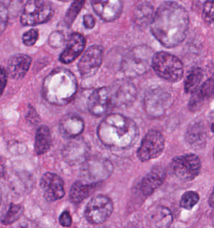 | 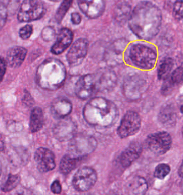 |

**Referencia:** Tumor no mitótico. **Predicción:** Tumor no mitótico. **Resultado:** acierto. Modelo `resnet50`, semilla 6113. Tipo de anotación: `polyline`. La comparación permite localizar qué núcleo se clasificó; no demuestra qué región utilizó el modelo.

### Caso 07: Tumor no mitótico

| Campo limpio original | Núcleo objetivo anotado |
|---|---|
| 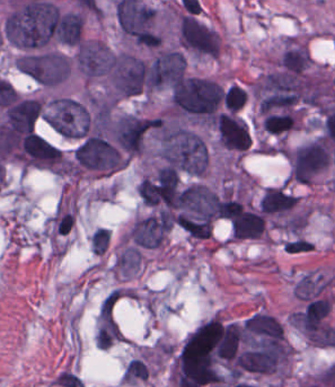 | 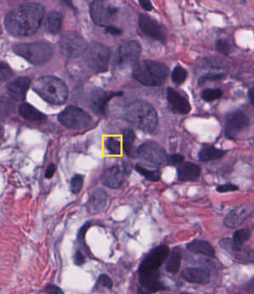 |

**Referencia:** Tumor no mitótico. **Predicción:** Linfocito. **Resultado:** discrepancia. Modelo `resnet50`, semilla 6113. Tipo de anotación: `rectangle`. La comparación permite localizar qué núcleo se clasificó; no demuestra qué región utilizó el modelo.

### Caso 13: Linfocito

| Campo limpio original | Núcleo objetivo anotado |
|---|---|
| 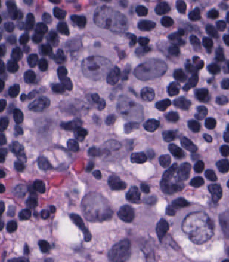 | 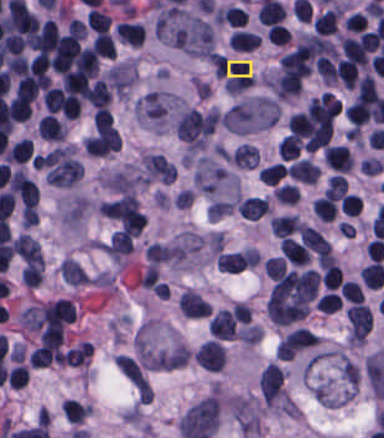 |

**Referencia:** Linfocito. **Predicción:** Linfocito. **Resultado:** acierto. Modelo `resnet50`, semilla 6113. Tipo de anotación: `rectangle`. La comparación permite localizar qué núcleo se clasificó; no demuestra qué región utilizó el modelo.

### Caso 19: Linfocito

| Campo limpio original | Núcleo objetivo anotado |
|---|---|
| 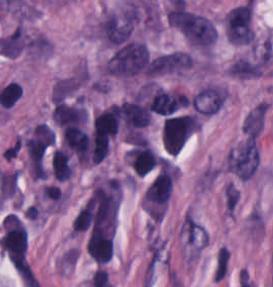 | 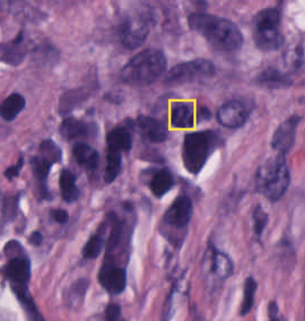 |

**Referencia:** Linfocito. **Predicción:** Tumor no mitótico. **Resultado:** discrepancia. Modelo `resnet50`, semilla 6113. Tipo de anotación: `rectangle`. La comparación permite localizar qué núcleo se clasificó; no demuestra qué región utilizó el modelo.

### Caso 25: Estroma no TIL / no macrófago

| Campo limpio original | Núcleo objetivo anotado |
|---|---|
| 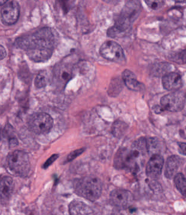 | 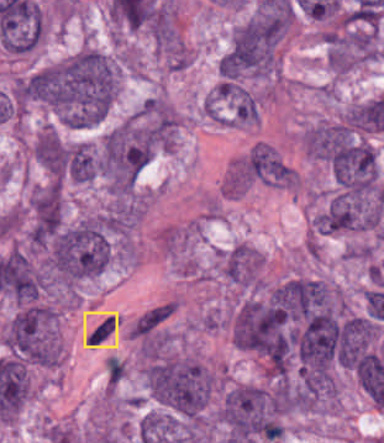 |

**Referencia:** Estroma no TIL / no macrófago. **Predicción:** Estroma no TIL / no macrófago. **Resultado:** acierto. Modelo `resnet50`, semilla 6113. Tipo de anotación: `rectangle`. La comparación permite localizar qué núcleo se clasificó; no demuestra qué región utilizó el modelo.

### Caso 31: Estroma no TIL / no macrófago

| Campo limpio original | Núcleo objetivo anotado |
|---|---|
| 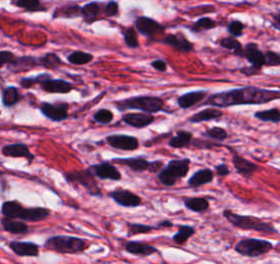 | 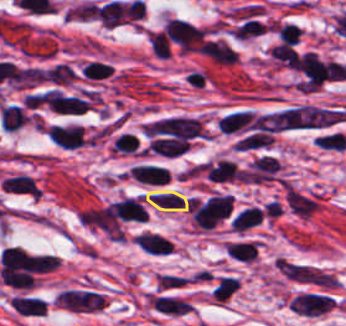 |

**Referencia:** Estroma no TIL / no macrófago. **Predicción:** Linfocito. **Resultado:** discrepancia. Modelo `resnet50`, semilla 6113. Tipo de anotación: `polyline`. La comparación permite localizar qué núcleo se clasificó; no demuestra qué región utilizó el modelo.

## Los 36 casos y sus probabilidades

Las imágenes siguientes conservan la anotación original. En cada caso se registran clase de referencia, predicción y probabilidades de las tres clases. La selección priorizó diversidad de pacientes con desempate determinista; incluye dos casos por combinación modelo × clase × resultado.

### Caso 01 · Acierto

**Referencia:** Tumor no mitótico. **Predicción:** Tumor no mitótico. Modelo `resnet50`, semilla 6113.

| Tumor no mitótico | Linfocito | Estroma |
|---:|---:|---:|
| 98.98% | 0.01% | 1.01% |

Paciente del conjunto público: `TCGA-BH-A18V`; fila `0`; anotación `polyline`; campo 362 × 385 píxeles.

### Caso 02 · Acierto

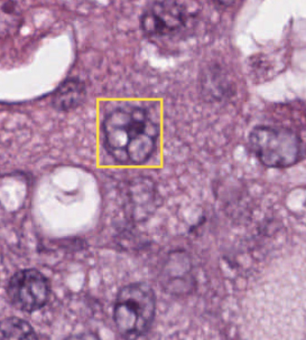

**Referencia:** Tumor no mitótico. **Predicción:** Tumor no mitótico. Modelo `resnet50`, semilla 6113.

| Tumor no mitótico | Linfocito | Estroma |
|---:|---:|---:|
| 97.49% | 0.61% | 1.89% |

Paciente del conjunto público: `TCGA-OL-A5D6`; fila `1`; anotación `rectangle`; campo 335 × 373 píxeles.

### Caso 03 · Acierto

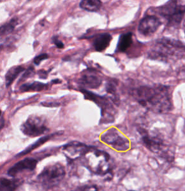

**Referencia:** Tumor no mitótico. **Predicción:** Tumor no mitótico. Modelo `densenet121`, semilla 6113.

| Tumor no mitótico | Linfocito | Estroma |
|---:|---:|---:|
| 95.61% | 0.09% | 4.30% |

Paciente del conjunto público: `TCGA-BH-A0B3`; fila `1`; anotación `polyline`; campo 360 × 372 píxeles.

### Caso 04 · Acierto

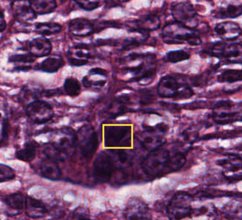

**Referencia:** Tumor no mitótico. **Predicción:** Tumor no mitótico. Modelo `densenet121`, semilla 6113.

| Tumor no mitótico | Linfocito | Estroma |
|---:|---:|---:|
| 93.98% | 2.12% | 3.90% |

Paciente del conjunto público: `TCGA-BH-A0B9`; fila `10`; anotación `rectangle`; campo 412 × 375 píxeles.

### Caso 05 · Acierto

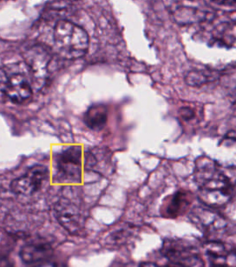

**Referencia:** Tumor no mitótico. **Predicción:** Tumor no mitótico. Modelo `softmaxcnn_bn`, semilla 6113.

| Tumor no mitótico | Linfocito | Estroma |
|---:|---:|---:|
| 99.51% | 0.09% | 0.40% |

Paciente del conjunto público: `TCGA-BH-A0E6`; fila `12`; anotación `rectangle`; campo 337 × 381 píxeles.

### Caso 06 · Acierto

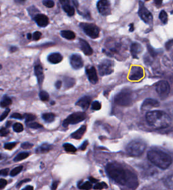

**Referencia:** Tumor no mitótico. **Predicción:** Tumor no mitótico. Modelo `softmaxcnn_bn`, semilla 6113.

| Tumor no mitótico | Linfocito | Estroma |
|---:|---:|---:|
| 62.79% | 34.59% | 2.61% |

Paciente del conjunto público: `TCGA-BH-A18G`; fila `19`; anotación `polyline`; campo 349 × 382 píxeles.

### Caso 07 · Discrepancia

**Referencia:** Tumor no mitótico. **Predicción:** Linfocito. Modelo `resnet50`, semilla 6113.

| Tumor no mitótico | Linfocito | Estroma |
|---:|---:|---:|
| 27.47% | 57.64% | 14.89% |

Paciente del conjunto público: `TCGA-AQ-A04J`; fila `30`; anotación `rectangle`; campo 368 × 425 píxeles.

### Caso 08 · Discrepancia

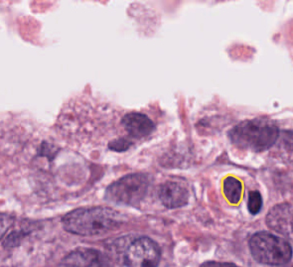

**Referencia:** Tumor no mitótico. **Predicción:** Estroma no TIL / no macrófago. Modelo `resnet50`, semilla 6113.

| Tumor no mitótico | Linfocito | Estroma |
|---:|---:|---:|
| 34.41% | 27.54% | 38.05% |

Paciente del conjunto público: `TCGA-AQ-A54N`; fila `10`; anotación `polyline`; campo 364 × 332 píxeles.

### Caso 09 · Discrepancia

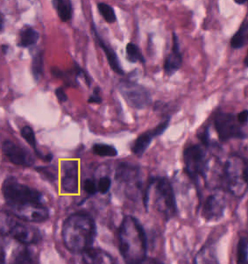

**Referencia:** Tumor no mitótico. **Predicción:** Estroma no TIL / no macrófago. Modelo `densenet121`, semilla 6113.

| Tumor no mitótico | Linfocito | Estroma |
|---:|---:|---:|
| 15.64% | 14.85% | 69.52% |

Paciente del conjunto público: `TCGA-BH-A0BL`; fila `9`; anotación `rectangle`; campo 354 × 376 píxeles.

### Caso 10 · Discrepancia

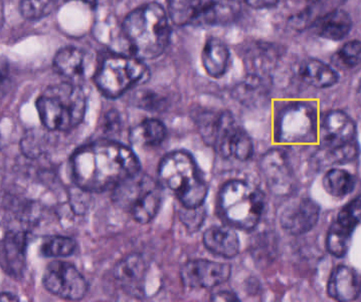

**Referencia:** Tumor no mitótico. **Predicción:** Estroma no TIL / no macrófago. Modelo `densenet121`, semilla 6113.

| Tumor no mitótico | Linfocito | Estroma |
|---:|---:|---:|
| 48.21% | 2.18% | 49.61% |

Paciente del conjunto público: `TCGA-BH-A0BW`; fila `11`; anotación `rectangle`; campo 449 × 376 píxeles.

### Caso 11 · Discrepancia

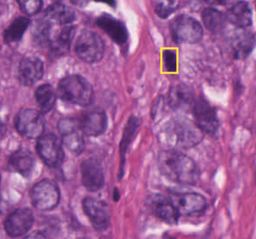

**Referencia:** Tumor no mitótico. **Predicción:** Linfocito. Modelo `softmaxcnn_bn`, semilla 6113.

| Tumor no mitótico | Linfocito | Estroma |
|---:|---:|---:|
| 19.36% | 56.08% | 24.55% |

Paciente del conjunto público: `TCGA-BH-A1EW`; fila `26`; anotación `rectangle`; campo 365 × 341 píxeles.

### Caso 12 · Discrepancia

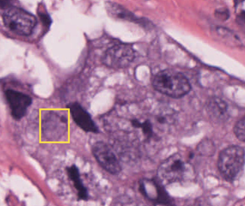

**Referencia:** Tumor no mitótico. **Predicción:** Estroma no TIL / no macrófago. Modelo `softmaxcnn_bn`, semilla 6113.

| Tumor no mitótico | Linfocito | Estroma |
|---:|---:|---:|
| 28.53% | 0.58% | 70.89% |

Paciente del conjunto público: `TCGA-BH-A1F6`; fila `5`; anotación `rectangle`; campo 409 × 343 píxeles.

### Caso 13 · Acierto

**Referencia:** Linfocito. **Predicción:** Linfocito. Modelo `resnet50`, semilla 6113.

| Tumor no mitótico | Linfocito | Estroma |
|---:|---:|---:|
| 2.86% | 94.35% | 2.79% |

Paciente del conjunto público: `TCGA-AQ-A04J`; fila `105`; anotación `rectangle`; campo 384 × 438 píxeles.

### Caso 14 · Acierto

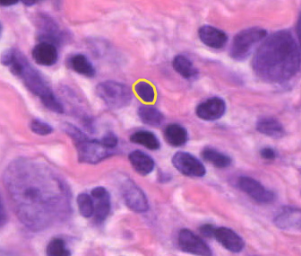

**Referencia:** Linfocito. **Predicción:** Linfocito. Modelo `resnet50`, semilla 6113.

| Tumor no mitótico | Linfocito | Estroma |
|---:|---:|---:|
| 9.61% | 69.10% | 21.28% |

Paciente del conjunto público: `TCGA-OL-A6VO`; fila `12`; anotación `polyline`; campo 336 × 285 píxeles.

### Caso 15 · Acierto

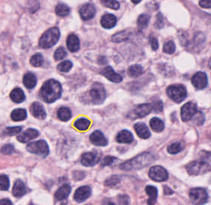

**Referencia:** Linfocito. **Predicción:** Linfocito. Modelo `densenet121`, semilla 6113.

| Tumor no mitótico | Linfocito | Estroma |
|---:|---:|---:|
| 0.30% | 99.37% | 0.33% |

Paciente del conjunto público: `TCGA-BH-A0BG`; fila `11`; anotación `polyline`; campo 351 × 340 píxeles.

### Caso 16 · Acierto

**Referencia:** Linfocito. **Predicción:** Linfocito. Modelo `densenet121`, semilla 6113.

| Tumor no mitótico | Linfocito | Estroma |
|---:|---:|---:|
| 4.62% | 88.12% | 7.25% |

Paciente del conjunto público: `TCGA-BH-A0BL`; fila `11`; anotación `rectangle`; campo 354 × 376 píxeles.

### Caso 17 · Acierto

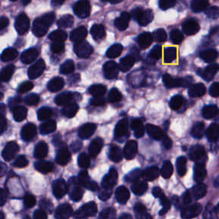

**Referencia:** Linfocito. **Predicción:** Linfocito. Modelo `softmaxcnn_bn`, semilla 6113.

| Tumor no mitótico | Linfocito | Estroma |
|---:|---:|---:|
| 0.66% | 98.47% | 0.87% |

Paciente del conjunto público: `TCGA-BH-A0WA`; fila `14`; anotación `rectangle`; campo 359 × 359 píxeles.

### Caso 18 · Acierto

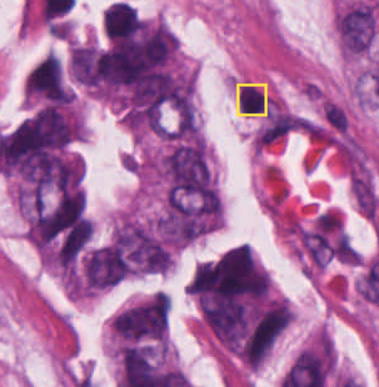

**Referencia:** Linfocito. **Predicción:** Linfocito. Modelo `softmaxcnn_bn`, semilla 6113.

| Tumor no mitótico | Linfocito | Estroma |
|---:|---:|---:|
| 16.46% | 62.05% | 21.50% |

Paciente del conjunto público: `TCGA-BH-A1EW`; fila `19`; anotación `rectangle`; campo 379 × 387 píxeles.

### Caso 19 · Discrepancia

**Referencia:** Linfocito. **Predicción:** Tumor no mitótico. Modelo `resnet50`, semilla 6113.

| Tumor no mitótico | Linfocito | Estroma |
|---:|---:|---:|
| 53.31% | 38.99% | 7.70% |

Paciente del conjunto público: `TCGA-BH-A0AV`; fila `21`; anotación `rectangle`; campo 338 × 355 píxeles.

### Caso 20 · Discrepancia

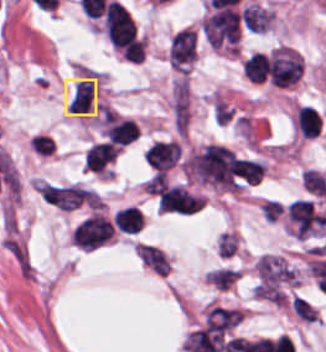

**Referencia:** Linfocito. **Predicción:** Estroma no TIL / no macrófago. Modelo `resnet50`, semilla 6113.

| Tumor no mitótico | Linfocito | Estroma |
|---:|---:|---:|
| 1.95% | 13.50% | 84.55% |

Paciente del conjunto público: `TCGA-BH-A0B3`; fila `25`; anotación `rectangle`; campo 326 × 352 píxeles.

### Caso 21 · Discrepancia

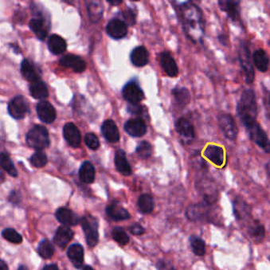

**Referencia:** Linfocito. **Predicción:** Tumor no mitótico. Modelo `densenet121`, semilla 6113.

| Tumor no mitótico | Linfocito | Estroma |
|---:|---:|---:|
| 54.56% | 26.70% | 18.74% |

Paciente del conjunto público: `TCGA-BH-A0E0`; fila `17`; anotación `polyline`; campo 339 × 339 píxeles.

### Caso 22 · Discrepancia

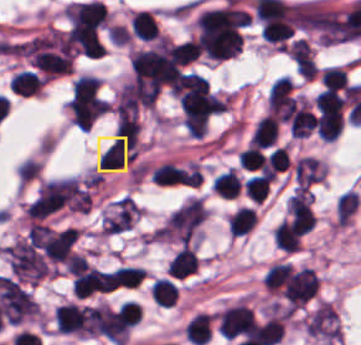

**Referencia:** Linfocito. **Predicción:** Estroma no TIL / no macrófago. Modelo `densenet121`, semilla 6113.

| Tumor no mitótico | Linfocito | Estroma |
|---:|---:|---:|
| 5.41% | 41.61% | 52.98% |

Paciente del conjunto público: `TCGA-BH-A0E6`; fila `31`; anotación `rectangle`; campo 361 × 345 píxeles.

### Caso 23 · Discrepancia

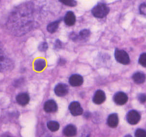

**Referencia:** Linfocito. **Predicción:** Estroma no TIL / no macrófago. Modelo `softmaxcnn_bn`, semilla 6113.

| Tumor no mitótico | Linfocito | Estroma |
|---:|---:|---:|
| 33.52% | 18.39% | 48.09% |

Paciente del conjunto público: `TCGA-OL-A66I`; fila `14`; anotación `polyline`; campo 301 × 283 píxeles.

### Caso 24 · Discrepancia

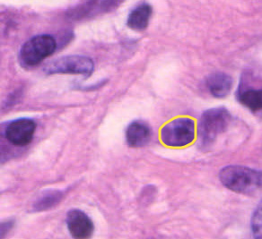

**Referencia:** Linfocito. **Predicción:** Tumor no mitótico. Modelo `softmaxcnn_bn`, semilla 6113.

| Tumor no mitótico | Linfocito | Estroma |
|---:|---:|---:|
| 82.69% | 1.08% | 16.23% |

Paciente del conjunto público: `TCGA-OL-A66P`; fila `2`; anotación `polyline`; campo 292 × 267 píxeles.

### Caso 25 · Acierto

**Referencia:** Estroma no TIL / no macrófago. **Predicción:** Estroma no TIL / no macrófago. Modelo `resnet50`, semilla 6113.

| Tumor no mitótico | Linfocito | Estroma |
|---:|---:|---:|
| 17.60% | 6.18% | 76.22% |

Paciente del conjunto público: `TCGA-AQ-A54N`; fila `7`; anotación `rectangle`; campo 384 × 443 píxeles.

### Caso 26 · Acierto

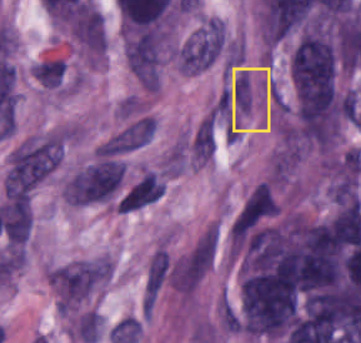

**Referencia:** Estroma no TIL / no macrófago. **Predicción:** Estroma no TIL / no macrófago. Modelo `resnet50`, semilla 6113.

| Tumor no mitótico | Linfocito | Estroma |
|---:|---:|---:|
| 36.83% | 1.91% | 61.26% |

Paciente del conjunto público: `TCGA-BH-A0AV`; fila `12`; anotación `rectangle`; campo 361 × 343 píxeles.

### Caso 27 · Acierto

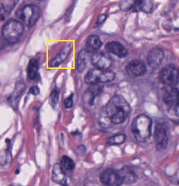

**Referencia:** Estroma no TIL / no macrófago. **Predicción:** Estroma no TIL / no macrófago. Modelo `densenet121`, semilla 6113.

| Tumor no mitótico | Linfocito | Estroma |
|---:|---:|---:|
| 10.50% | 1.54% | 87.96% |

Paciente del conjunto público: `TCGA-BH-A0BW`; fila `15`; anotación `rectangle`; campo 356 × 371 píxeles.

### Caso 28 · Acierto

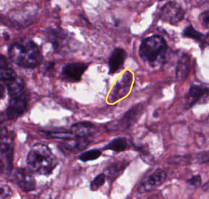

**Referencia:** Estroma no TIL / no macrófago. **Predicción:** Estroma no TIL / no macrófago. Modelo `densenet121`, semilla 6113.

| Tumor no mitótico | Linfocito | Estroma |
|---:|---:|---:|
| 35.04% | 4.92% | 60.04% |

Paciente del conjunto público: `TCGA-BH-A0E0`; fila `4`; anotación `polyline`; campo 356 × 339 píxeles.

### Caso 29 · Acierto

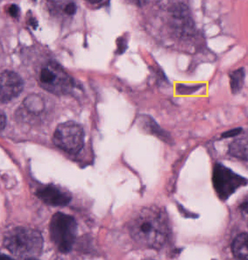

**Referencia:** Estroma no TIL / no macrófago. **Predicción:** Estroma no TIL / no macrófago. Modelo `softmaxcnn_bn`, semilla 6113.

| Tumor no mitótico | Linfocito | Estroma |
|---:|---:|---:|
| 45.65% | 4.26% | 50.08% |

Paciente del conjunto público: `TCGA-BH-A1F6`; fila `15`; anotación `rectangle`; campo 354 × 371 píxeles.

### Caso 30 · Acierto

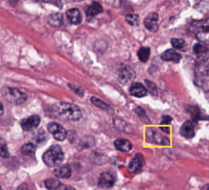

**Referencia:** Estroma no TIL / no macrófago. **Predicción:** Estroma no TIL / no macrófago. Modelo `softmaxcnn_bn`, semilla 6113.

| Tumor no mitótico | Linfocito | Estroma |
|---:|---:|---:|
| 18.43% | 3.94% | 77.63% |

Paciente del conjunto público: `TCGA-OL-A5D7`; fila `0`; anotación `rectangle`; campo 358 × 325 píxeles.

### Caso 31 · Discrepancia

**Referencia:** Estroma no TIL / no macrófago. **Predicción:** Linfocito. Modelo `resnet50`, semilla 6113.

| Tumor no mitótico | Linfocito | Estroma |
|---:|---:|---:|
| 1.72% | 88.27% | 10.00% |

Paciente del conjunto público: `TCGA-BH-A0B9`; fila `16`; anotación `polyline`; campo 346 × 326 píxeles.

### Caso 32 · Discrepancia

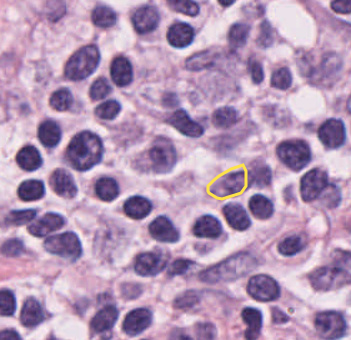

**Referencia:** Estroma no TIL / no macrófago. **Predicción:** Linfocito. Modelo `resnet50`, semilla 6113.

| Tumor no mitótico | Linfocito | Estroma |
|---:|---:|---:|
| 14.07% | 43.53% | 42.40% |

Paciente del conjunto público: `TCGA-BH-A0BG`; fila `12`; anotación `polyline`; campo 351 × 340 píxeles.

### Caso 33 · Discrepancia

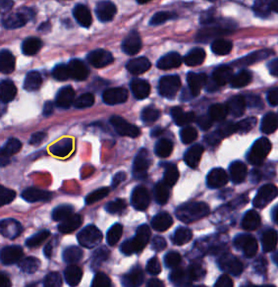

**Referencia:** Estroma no TIL / no macrófago. **Predicción:** Linfocito. Modelo `densenet121`, semilla 6113.

| Tumor no mitótico | Linfocito | Estroma |
|---:|---:|---:|
| 1.01% | 89.20% | 9.80% |

Paciente del conjunto público: `TCGA-BH-A0WA`; fila `30`; anotación `polyline`; campo 351 × 362 píxeles.

### Caso 34 · Discrepancia

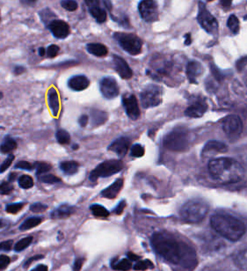

**Referencia:** Estroma no TIL / no macrófago. **Predicción:** Linfocito. Modelo `densenet121`, semilla 6113.

| Tumor no mitótico | Linfocito | Estroma |
|---:|---:|---:|
| 4.05% | 48.30% | 47.64% |

Paciente del conjunto público: `TCGA-BH-A18G`; fila `13`; anotación `polyline`; campo 349 × 382 píxeles.

### Caso 35 · Discrepancia

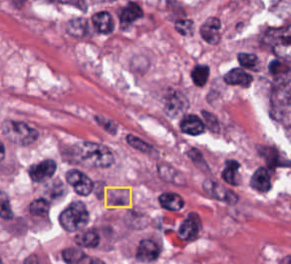

**Referencia:** Estroma no TIL / no macrófago. **Predicción:** Tumor no mitótico. Modelo `softmaxcnn_bn`, semilla 6113.

| Tumor no mitótico | Linfocito | Estroma |
|---:|---:|---:|
| 76.95% | 1.95% | 21.11% |

Paciente del conjunto público: `TCGA-OL-A5D7`; fila `25`; anotación `rectangle`; campo 358 × 325 píxeles.

### Caso 36 · Discrepancia

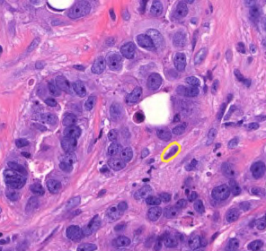

**Referencia:** Estroma no TIL / no macrófago. **Predicción:** Tumor no mitótico. Modelo `softmaxcnn_bn`, semilla 6113.

| Tumor no mitótico | Linfocito | Estroma |
|---:|---:|---:|
| 94.75% | 0.16% | 5.09% |

Paciente del conjunto público: `TCGA-OL-A5RW`; fila `31`; anotación `polyline`; campo 296 × 280 píxeles.

## Procedencia, control y límites

Fuente: galería ampliada E2 del 15 de noviembre, cotejada contra campos QC y predicciones de validación. La auditoría de origen informa 6.147 predicciones sobre 2.049 núcleos de 21 pacientes. En esta integración se verificó nuevamente el SHA-256 de los bytes PNG contenidos en cada SVG frente a la huella registrada para los 36 campos. Esto acredita identidad de archivos, no una nueva revisión anatomopatológica.

La selección de 18 aciertos y 18 discrepancias **no significa una exactitud del 50 %**. Tampoco cumple por sí sola la revisión de 100 errores por modelo principal ni el acuerdo entre anotadores independientes. No se muestran imágenes de reserva. Las predicciones son de E2, no de CICO.

[Visor interactivo con filtros y ampliación](https://nucls-entregable3.onrender.com/histologia) · [Trazabilidad de los 36 casos](https://nucls-entregable3.onrender.com/histologia-evidencia/casos.json).
