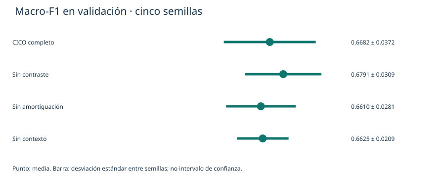

# Ablaciones verificadas y transición a PCam

Se recibieron y verificaron **15/15 ablaciones** (tres variantes × cinco semillas), además del piloto CICO de cinco semillas. Los 91 archivos del respaldo coinciden con su manifiesto SHA-256. Pesos y predicciones coinciden con las huellas registradas. Las métricas se recalcularon desde las probabilidades.

Las 20 corridas comparten las mismas **2.049 imágenes de 21 pacientes**, en el mismo orden y con las mismas etiquetas. El checkpoint se seleccionó por validación: esta comparación es exploratoria, no un test independiente.

| Variante | Macro-F1 medio | SD | Δ frente a CICO | p pareada | p Holm (3) |
|---|---:|---:|---:|---:|---:|
| CICO completo | 0.6682 | 0.0372 | +0.0000 | — | — |
| Sin contraste | 0.6791 | 0.0309 | +0.0109 | 0.125 | 0.375 |
| Sin amortiguación | 0.6610 | 0.0281 | -0.0072 | 1.0 | 1 |
| Sin contexto | 0.6625 | 0.0209 | -0.0057 | 0.875 | 1 |

**Interpretación:** el modelo completo no supera consistentemente las variantes. Quitar contraste presenta una media mayor, pero ninguna comparación resulta significativa. Ausencia de significación no demuestra equivalencia ni ausencia de efecto. No se cambia el modelo desplegado por esta comparación post hoc.

La prueba exploratoria es una permutación exacta pareada bilateral de los signos de las diferencias entre semillas (32 asignaciones), seguida de Holm sobre tres contrastes. Con cinco semillas hay poca resolución; no sustituye las pruebas, potencia y mínimo de diez semillas exigidos en E3. SD describe variación entre entrenamientos y no incertidumbre sobre pacientes.

## Registro de corridas

| Variante | Semilla | Mejor época | Última época | Macro-F1 |
|---|---:|---:|---:|---:|
| CICO completo | 6101 | 22 | 25 | 0.7174 |
| CICO completo | 6102 | 18 | 23 | 0.6993 |
| CICO completo | 6103 | 1 | 6 | 0.6421 |
| CICO completo | 6104 | 1 | 6 | 0.6399 |
| CICO completo | 6105 | 1 | 6 | 0.6425 |
| Sin contraste | 6101 | 22 | 25 | 0.7081 |
| Sin contraste | 6102 | 18 | 23 | 0.7168 |
| Sin contraste | 6103 | 4 | 9 | 0.6617 |
| Sin contraste | 6104 | 1 | 6 | 0.6497 |
| Sin contraste | 6105 | 1 | 6 | 0.6594 |
| Sin amortiguación | 6101 | 11 | 16 | 0.6783 |
| Sin amortiguación | 6102 | 18 | 23 | 0.7025 |
| Sin amortiguación | 6103 | 1 | 6 | 0.6421 |
| Sin amortiguación | 6104 | 1 | 6 | 0.6399 |
| Sin amortiguación | 6105 | 1 | 6 | 0.6425 |
| Sin contexto | 6101 | 11 | 16 | 0.6753 |
| Sin contexto | 6102 | 18 | 23 | 0.6933 |
| Sin contexto | 6103 | 4 | 9 | 0.6480 |
| Sin contexto | 6104 | 1 | 6 | 0.6460 |
| Sin contexto | 6105 | 1 | 6 | 0.6501 |

Las curvas completas y el archivo descargable están en [Ablaciones del dashboard](https://nucls-entregable3.onrender.com/ablaciones). Se conserva la parada temprana real; no se inventan épocas faltantes.

## Qué falta

- Controles base sin todos los componentes y cada componente por separado; control sin D4 y ajuste por capacidad cuando corresponda.
- Benchmark final con Top10 y bases fuertes bajo política común, mínimo diez semillas y potencia objetivo 0,90.
- Partición confirmatoria independiente, tres datasets externos y protocolo congelado antes de analizar sus resultados.
- Pruebas complementarias exigidas, intervalos de efecto, corrección por familia y reporte de resultados negativos.

## PCam (E2)

Respaldo verificado del 22 de noviembre: 8301 completa; 8302 con época 19 guardada; 8303–8305 pendientes en ese corte. El autor comunica continuación en Colab; no es monitoreo en vivo ni un resultado nuevo verificado. Desde ese respaldo quedan 61 épocas (1 de 8302 y 60 de 8303–8305), más test y resumen. Se omiten semillas completas y se recuperan pesos, optimizador y estados aleatorios; no se repite lo guardado.

Respaldo de ablaciones SHA-256: `e7a0d21c4c9cb034ef6efc06de3ed3bc4db58b6fb2cdf8891ec0f5c0da9e0ed6`.
