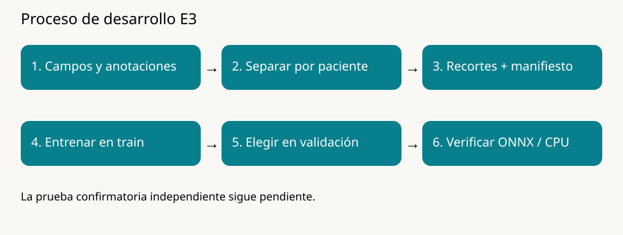
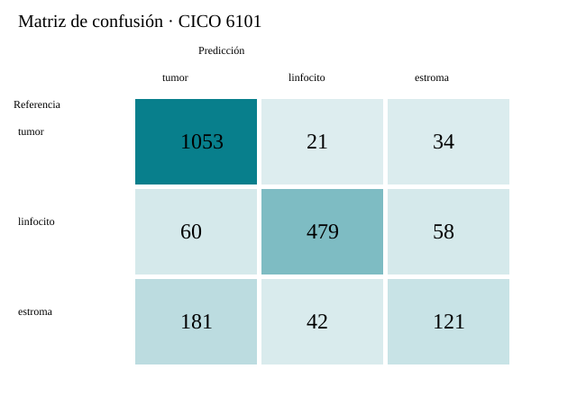
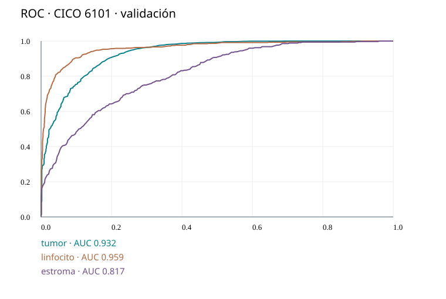
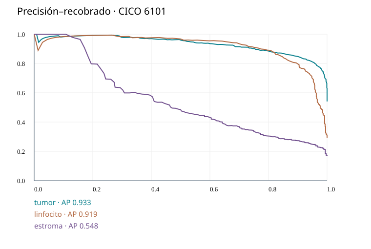
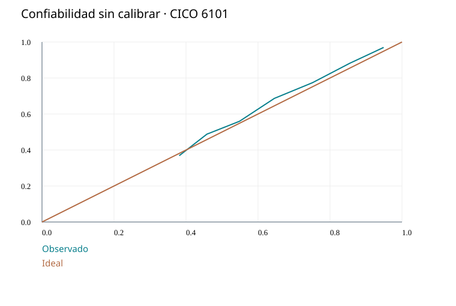

# Contexto, diagnósticos y comparación exploratoria

Actualización documental CPU del 21 de noviembre de 2026. No modifica E1, el ZIP entregado, pesos, particiones ni entrenamientos activos. Las hipótesis aquí explicitadas son una formalización posterior al piloto, **no un preregistro retroactivo**.

## Pregunta e hipótesis

**Pregunta:** ¿una corrección contextual acotada por desacuerdo entre orientaciones mejora la clasificación nuclear frente a referencias evaluadas con el mismo protocolo y partición?

**Hipótesis de desempeño:** CICO mejora el Macro-F1 frente a las referencias. Para una confirmación se necesita fijar previamente el margen mínimo de interés, la familia de contrastes y su potencia; esos requisitos no están satisfechos por el piloto.

**Hipótesis de mecanismo:** al retirar contexto, contraste u amortiguación cambia el desempeño y el presupuesto contextual observado. Las ablaciones prueban intervenciones concretas; una propiedad algebraica no implica mejora predictiva. Los controles de componentes y sin D4 siguen pendientes de ejecución verificada.

## Data Card resumida

| Campo | Descripción |
|---|---|
| Fuente | Recortes NuCLS derivados de anotaciones nucleares y campos TCGA; procedencia de archivos en manifiesto |
| Unidad de predicción | Núcleo objetivo localizado en un recorte RGB de 128 × 128 |
| Clases | tumor_nonMitotic, lymphocyte, nonTILnonMQ_stromal |
| Entrenamiento E3 | 14.539 recortes / 83 pacientes |
| Validación E3 | 2.049 recortes / 21 pacientes; usada para seleccionar checkpoints |
| Unidad independiente | Paciente; los recortes del mismo paciente no son independientes |
| Reserva histórica E2 | 969 recortes / 6 pacientes, ya observada; no es test nuevo E3 |
| Preprocesamiento de inferencia | División por 255 y normalización de train preservada en el artefacto; no redimensiona |
| Acceso y reutilización | Respetar condiciones de las fuentes NuCLS/TCGA; los ejemplos no otorgan una licencia nueva |
| Riesgos | Cambio entre pacientes/sitios, etiquetas imperfectas, baja diversidad de reserva; uso experimental |

## Proceso y responsabilidades



**Campos y anotaciones → separación por paciente → recortes y manifiesto con hashes → entrenamiento en train → selección en validación → congelación y verificación ONNX → dashboard CPU.** La confirmación externa independiente es una etapa pendiente, separada de esta cadena de desarrollo.

Autor: Andrés Duarte. Versión: revisión CPU 21 noviembre 2026. [Ficha del modelo y privacidad](https://nucls-entregable3.onrender.com/documentacion). El material constituye investigación computacional, no una herramienta de diagnóstico. La revisión bibliográfica con un único revisor se interpreta como revisión crítica dirigida; no acredita cribado independiente por duplicado.

## Pseudocódigo de CICO

```text
para cada una de las ocho orientaciones D4:
    características = encoder compartido(recorte orientado)
    centro = promedio de ventana central de características
    entorno = promedio del complemento de esa ventana
    contraste = entorno − centro
promediar centro, entorno y contraste entre orientaciones
V = dispersión del contraste entre orientaciones
puerta = sigmoide(proyección de centro y entorno medios)
presupuesto = beta × puerta / (1 + lambda × V)
corrección = presupuesto × tanh(proyección del contraste medio) / raíz(K)
logits = proyección del centro medio + corrección
```

La región central no es una máscara segmentada. La cota de norma de la corrección es beta; no prueba robustez clínica, novedad ni superioridad. La similitud con mecanismos de contexto de la literatura debe discutirse y no ocultarse.

## Diagnósticos

Las figuras siguientes corresponden a la semilla 6101, elegida por validación. El [dashboard de diagnósticos](https://nucls-entregable3.onrender.com/diagnosticos) permite explorar las cinco semillas. Ninguna figura es evaluación de test nuevo.



La diagonal cuenta aciertos y las celdas fuera de ella las confusiones. Los recuentos no se normalizan y no representan pacientes independientes.



Eje horizontal: tasa de falsos positivos; vertical: sensibilidad. AUC usa todos los umbrales, uno contra el resto; el dibujo reduce puntos para visualización.



Eje horizontal: recobrado; vertical: precisión. La AP resume la curva con incrementos de recobrado; no es el área trapezoidal. Depende de la prevalencia de cada clase.



Eje horizontal: confianza máxima media; vertical: fracción correcta, en diez intervalos fijos. La separación de la diagonal muestra desajuste de confianza. No se ajustó calibración ni se acredita cobertura nominal.

| Semilla | Macro-F1 | Brier multiclase | ECE fijo 10 |
|---|---:|---:|---:|
| 6101 | 0.7174 | 0.2794 | 0.0239 |
| 6102 | 0.6993 | 0.2961 | 0.0287 |
| 6103 | 0.6421 | 0.3987 | 0.0740 |
| 6104 | 0.6399 | 0.4050 | 0.0667 |
| 6105 | 0.6425 | 0.3906 | 0.0785 |

## Contraste mínimo en la misma partición

Comparación exploratoria post hoc en validación compartida: 2.049 recortes, 21 pacientes, cinco semillas emparejadas. No test sellado ni comparación de presupuestos de ajuste equivalentes.

Se cotejaron archivos, pacientes y etiquetas uno a uno; cinco semillas 6101–6105 en cada modelo. Se promedian métricas por semilla, no predicciones de un ensamble.

| Referencia | CICO | Base | Δ CICO − base | d_z | p bilateral | p Holm | MDE 80% aproximada |
|---|---:|---:|---:|---:|---:|---:|---:|
| softmaxcnn_bn | 0.6682 | 0.7509 | -0.0827 | -1.875 | 0.0625 | 0.1875 | 0.0638 |
| densenet121 | 0.6682 | 0.7692 | -0.1010 | -1.878 | 0.0625 | 0.1875 | 0.0778 |
| resnet50 | 0.6682 | 0.7843 | -0.1160 | -2.984 | 0.0625 | 0.1875 | 0.0563 |

**Veredicto:** CICO queda descriptivamente por debajo de las tres bases en este corte; no se demuestra superioridad ni equivalencia. Wilcoxon bilateral exacto, con eliminación de diferencias cero y rangos medios en empates; Holm para tres contrastes. Se asume simetría de las diferencias bajo la hipótesis nula. d_z usa DE muestral de diferencias.

Con cinco diferencias no nulas, el menor p bilateral exacto de Wilcoxon es 2/32=0,0625: no puede alcanzar alfa 0,05, incluso antes de Holm. No se acredita potencia 0,80. MDE normal aproximada (Bonferroni 3, 80%) es orientativa para planificación, no potencia del test exacto ni garantía de tamaño muestral. La aproximación MDE emplea (z de 1−0,05/6 + z de 0,80) × DE de diferencias / raíz(5).

El pareamiento mide variación entre entrenamientos sobre pacientes fijos; no sustituye incertidumbre por paciente ni demuestra generalización. Los presupuestos históricos de entrenamiento y selección difieren. Por ello no se presenta como prueba de la condición confirmatoria R3.

## Calidad y dominio

Se verificaron hashes de los 16.588 PNG disponibles en train/validación. [EDA E3 con filtros comunes](https://nucls-entregable3.onrender.com/eda-e3) publica intensidades por canal y clase y duplicados exactos.

Grupos de píxeles repetidos: 0; compartidos entre particiones: 0; con etiquetas contradictorias: 0. Igualdad exacta de píxeles; no descarta duplicados aproximados ni ruido semántico de etiqueta. No sustituye la revisión de 100 errores por modelo ni permite estimar un techo multi-anotador.

El formulario rechaza imágenes uniformes o casi uniformes y advierte expresamente que el dominio no se verifica. **Este filtro básico no es un detector H&E validado ni un método de incertidumbre con cobertura.** Una imagen ajena al dominio puede superar el filtro. RGBA totalmente opaco se convierte a RGB sin alterar los canales de color; alfa parcial se rechaza.

## Pendientes que esta actualización no resuelve

PCam; integración de ablaciones nuevas; controles completos; estabilidad del entrenamiento; comparación confirmatoria Top-10 con protocolo común y potencia; tres conjuntos externos; calibración/cobertura independiente; validación de explicaciones de Inception; novedad acreditada; DOI, firmas y reproducción independiente. El diagrama de diferencia crítica confirmatorio no se fabrica a partir de cinco semillas ni de particiones mezcladas.

## Costos y frontera descriptiva

Se publica una [tabla conjunta de costos históricos E2](https://nucls-entregable3.onrender.com/costos): parámetros, FLOPs de operaciones cubiertas, latencia por recorte en batch32, Brier y ECE sin recalibración por arquitectura. La frontera minimiza parámetros y maximiza Macro-F1 medio de la misma reserva histórica. Es descriptiva, no incorpora incertidumbre ni sustituye contraste estadístico.

CICO tiene 7.671 parámetros y 340.312.585 operaciones cubiertas por el profiler para batch1 RGB 128 × 128. Su latencia CPU local se informa separadamente de GPU histórica. CICO no se añade a una frontera de rendimiento que utiliza otra partición.

## Reproducción de los cálculos CPU

Los programas `tools/revision_diagnosticos.py` y `tools/contrastes_cico.py` reciben las rutas de los ZIP de datos/piloto y de la evidencia base auditada. Leen los resultados, comprueban hashes y generan los agregados; no ejecutan entrenamiento. La comparación conserva huellas por modelo y semilla en `data/diagnosticos/contrastes.json`. La prueba HTTP del despliegue usa únicamente píxeles artificiales mediante `tools/prueba_render.py`.
