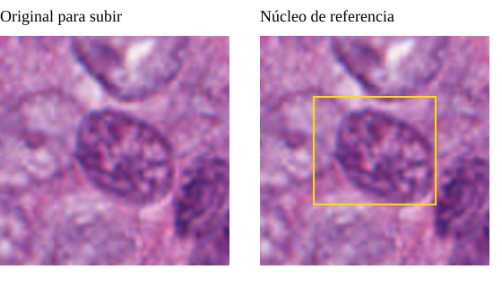
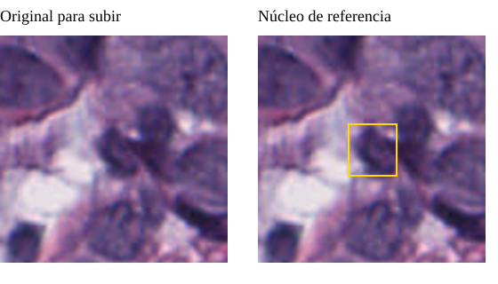
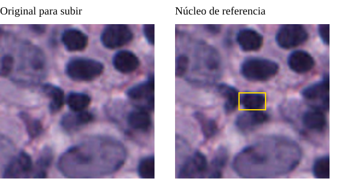
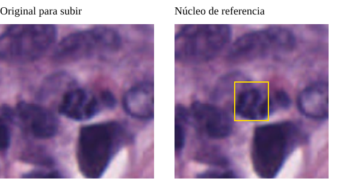
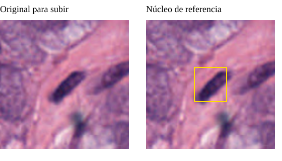
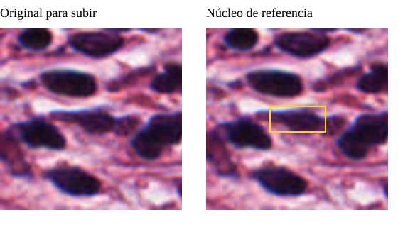

# Ejemplos histológicos listos para predicción

Seis recortes de validación, elegidos de la galería histórica E2 antes de calcular su predicción CICO. La referencia procede del manifiesto y la anotación, no de una nueva evaluación clínica. Los PNG originales se descargan desde [Ejemplos](https://nucls-entregable3.onrender.com/ejemplos). No usar las vistas anotadas como entrada.

## Caso 01: Tumor no mitótico

La anotación identifica el núcleo objetivo como tumoral no mitótico. La referencia corresponde a ese núcleo; no significa que todo el tejido del recorte sea tumor. **CICO 6101:** tumor; coincide con la referencia. tumor: 91.3% · linfocito: 1.4% · estroma: 7.3%.

La caja es el rectángulo delimitador de la anotación, no segmentación ni atención. La clase se refiere al núcleo objetivo y no a todo el tejido. [Descargar PNG original](https://nucls-entregable3.onrender.com/ejemplo-png/01).

## Caso 07: Tumor no mitótico

La anotación identifica el núcleo objetivo como tumoral no mitótico. La referencia corresponde a ese núcleo; no significa que todo el tejido del recorte sea tumor. **CICO 6101:** tumor; coincide con la referencia. tumor: 59.7% · linfocito: 21.6% · estroma: 18.7%.

La caja es el rectángulo delimitador de la anotación, no segmentación ni atención. La clase se refiere al núcleo objetivo y no a todo el tejido. [Descargar PNG original](https://nucls-entregable3.onrender.com/ejemplo-png/07).

## Caso 13: Linfocito

La anotación identifica el núcleo objetivo como linfocito. Los núcleos vecinos y el fondo son contexto y pueden pertenecer a otras clases. **CICO 6101:** linfocito; coincide con la referencia. tumor: 1.9% · linfocito: 91.7% · estroma: 6.4%.

La caja es el rectángulo delimitador de la anotación, no segmentación ni atención. La clase se refiere al núcleo objetivo y no a todo el tejido. [Descargar PNG original](https://nucls-entregable3.onrender.com/ejemplo-png/13).

## Caso 19: Linfocito

La anotación identifica el núcleo objetivo como linfocito. Los núcleos vecinos y el fondo son contexto y pueden pertenecer a otras clases. **CICO 6101:** tumor; discrepa con la referencia. tumor: 47.1% · linfocito: 44.5% · estroma: 8.4%.

La caja es el rectángulo delimitador de la anotación, no segmentación ni atención. La clase se refiere al núcleo objetivo y no a todo el tejido. [Descargar PNG original](https://nucls-entregable3.onrender.com/ejemplo-png/19).

## Caso 25: Estroma no TIL / no macrófago

La referencia agrupa el núcleo objetivo como estromal no TIL y no macrófago. El dashboard abrevia esta categoría como estroma; no representa todas las células no tumorales. **CICO 6101:** estroma; coincide con la referencia. tumor: 1.7% · linfocito: 38.4% · estroma: 59.9%.

La caja es el rectángulo delimitador de la anotación, no segmentación ni atención. La clase se refiere al núcleo objetivo y no a todo el tejido. [Descargar PNG original](https://nucls-entregable3.onrender.com/ejemplo-png/25).

## Caso 31: Estroma no TIL / no macrófago

La referencia agrupa el núcleo objetivo como estromal no TIL y no macrófago. El dashboard abrevia esta categoría como estroma; no representa todas las células no tumorales. **CICO 6101:** linfocito; discrepa con la referencia. tumor: 0.4% · linfocito: 91.8% · estroma: 7.8%.

La caja es el rectángulo delimitador de la anotación, no segmentación ni atención. La clase se refiere al núcleo objetivo y no a todo el tejido. [Descargar PNG original](https://nucls-entregable3.onrender.com/ejemplo-png/31).

## Interpretación

Se conservan cuatro coincidencias y dos discrepancias. Esta selección ilustrativa no estima precisión; los resultados fueron calculados localmente con el mismo ONNX desplegado. Los hashes permiten verificar que los recortes no se redimensionaron ni recolorearon.
